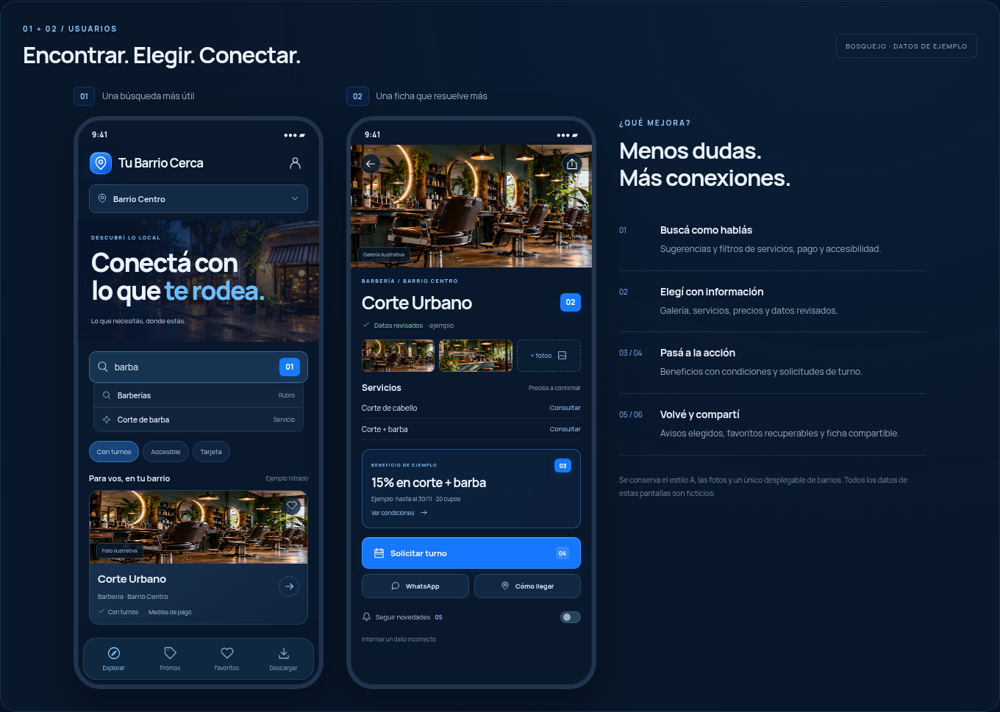
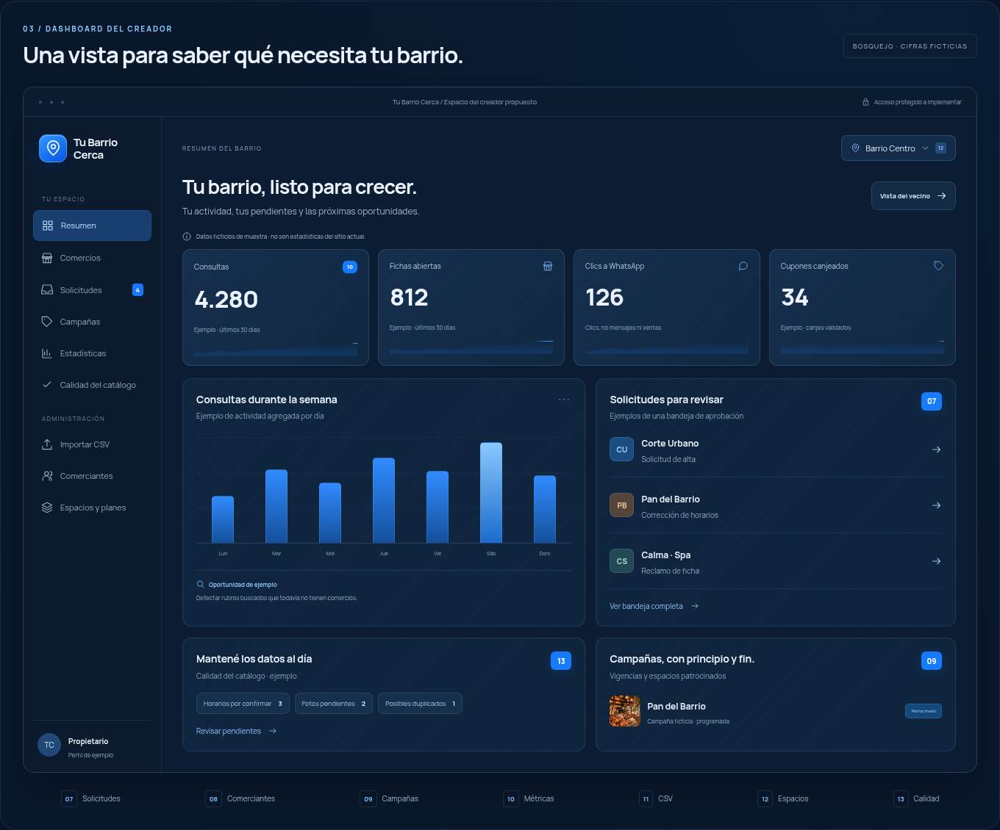
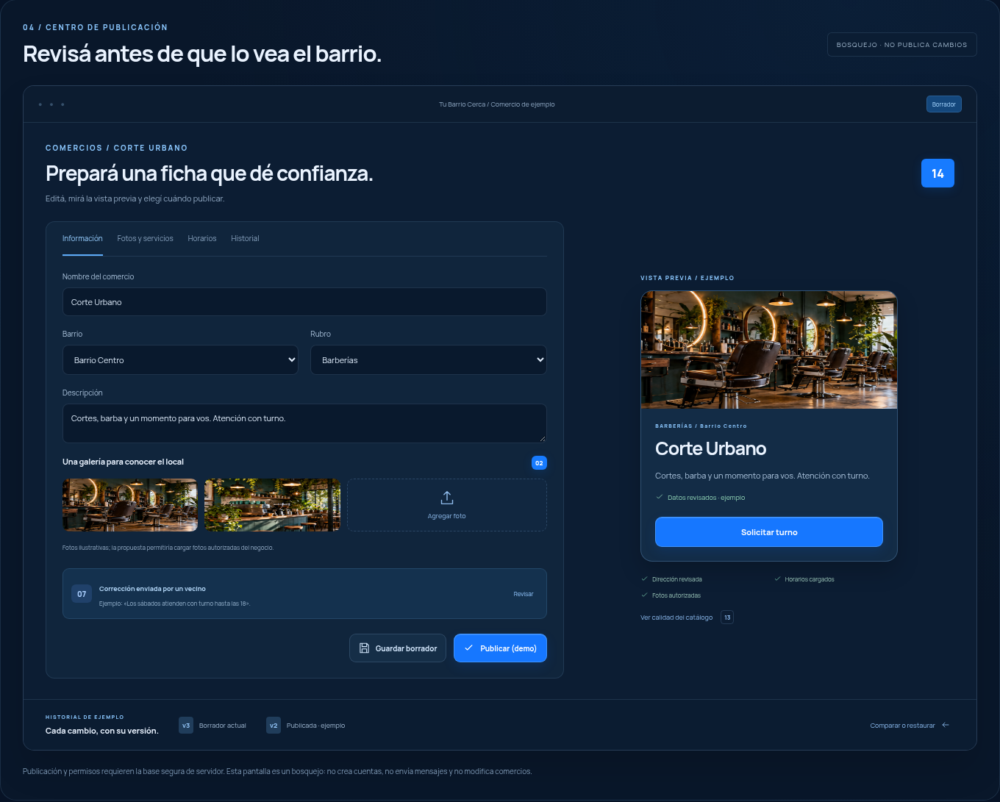

# Tu Barrio Cerca · propuestas del paso 2

Esta es una propuesta para elegir mejoras. **No modifica la web publicada ni habilita las funciones que muestra.** Conserva el formato A: azul noche, cobalto, superficies de vidrio, fotografías y contenido grande y legible. El eslogan sigue siendo «Conectá con lo que te rodea».

Los bosquejos usan **datos ficticios de muestra**. Las fotos actuales son ilustrativas; las cifras no representan actividad real, las ofertas no están vigentes y los dibujos de QR no habilitan canjes. No se agregan reseñas inventadas, publicaciones en tiendas ni promesas de reservas automáticas.

## Cuatro pantallas de referencia

Las dos pantallas móviles muestran búsqueda y ficha. Las otras dos muestran resumen y publicación del creador. Los números azules corresponden a las 14 ideas; no son 14 pantallas completas ni funciones habilitadas.

[Descargar el bosquejo interactivo y las imágenes](propuesta-revision.zip?raw=true). El paquete incluye un HTML autocontenido; los botones simulan recorridos y permiten marcar preferencias, sin modificar la aplicación.

### Usuarios: búsqueda y ficha

### Dashboard: resumen del creador

### Dashboard: revisión y publicación

## Lo que ya existe

El prototipo permite buscar por texto y rubro, filtrar abiertos, ordenar por cercanía, ver mapas, promociones y favoritos locales. En desarrollo existe un dashboard para comercios, rubros, barrios, destacados, marca y copias JSON. El público ya elige el barrio en un único desplegable; no puede agregar barrios desde la portada.

Las propuestas siguientes extienden esas capacidades o agregan funciones diferentes. **No se cuentan como nuevas las funciones que ya están implementadas.** Cada número representa un flujo completo, aunque tenga una parte para el vecino y otra para el creador.

## Base 0 · necesaria antes de un servicio comercial

Esta base no forma parte de las 14 mejoras. Se hereda del paso de seguridad: conectar API y base de datos, autenticar a los responsables, aplicar permisos por barrio desde el servidor y registrar las operaciones administrativas. El dashboard público permanece deshabilitado hasta contar con esos controles. No se reemplazan por una contraseña o un rol guardados en el navegador.

También deben comprobarse el acceso al sitio publicado, los dispositivos y la distribución móvil. La app de usuarios continúa permitiendo buscar y consultar sin exigir una cuenta. Una cuenta será opcional para las funciones que necesiten sincronización.

## Primera entrega recomendada · información confiable

Después de la Base 0, propongo una primera entrega limitada a **01, 02, 07, 13 y 14**. Conecta mejor búsqueda, fichas útiles y un circuito de revisión antes de publicar. Es preferible validar ese conjunto con comercios reales antes de sumar canjes, solicitudes y monetización.

### 01 · Búsqueda guiada y filtros de servicios

- **Diferencia con lo actual:** ya se puede buscar por nombre, descripción, dirección y rubro; falta buscar por prestaciones concretas.
- **Propuesta:** autocompletar servicios, rubros y comercios; filtros de turnos, entrega, medios de pago y accesibilidad, según los datos cargados. Si no hay resultados, sugerir otro servicio o rubro del mismo barrio sin inventar locales.
- **Valor:** el vecino encuentra quién puede resolver su necesidad y el comercio recibe consultas más pertinentes.
- **Dependencia:** catálogo compartido y servicios declarados y confirmados por cada local. No se deben mostrar filtros que no tengan información cargada.
- **Bosquejo:** buscador con filtros de servicio y resultados legibles. El barrio se elige únicamente en el desplegable.

### 02 · Ficha ampliada con galería, servicios/precios y datos revisados

- **Diferencia con lo actual:** la ficha tiene una imagen, descripción, dirección, horarios, WhatsApp y promoción; no tiene galería ni un catálogo de servicios.
- **Propuesta:** fotos reales autorizadas, servicios y precios informados por el local, fecha de revisión y una indicación precisa de qué datos fueron confirmados. El precio debe expresar sus condiciones, no presentarse como una cotización garantizada.
- **Valor:** permite comparar opciones y decidir antes de llamar o trasladarse.
- **Dependencia:** almacenamiento de imágenes con carga segura, responsables de actualización y validación de los datos. Un dato confirmado no implica una garantía de calidad del servicio.
- **Bosquejo:** portada fotográfica, galería, lista breve de servicios y accesos claros a contacto y recorrido.

### 07 · Bandeja de altas, correcciones y verificación de negocios

- **Diferencia con lo actual:** el creador carga todos los datos; no existe una bandeja de solicitudes de comerciantes o reportes de vecinos.
- **Propuesta:** recibir solicitudes para aparecer en un barrio ya habilitado, reclamos de una ficha propia y avisos de datos incorrectos. El administrador revisa, pide correcciones, aprueba o rechaza con motivo antes de publicar.
- **Valor:** reduce carga manual sin convertir las contribuciones externas en publicaciones automáticas.
- **Dependencia:** formularios protegidos, validación del servidor, estados de revisión y registro del responsable de cada decisión. La confirmación del comercio debe apoyarse en comprobación de contacto y revisión; no se compra con un plan pago.
- **Bosquejo:** bandeja con pendientes y panel de revisión. Los vecinos reportan o solicitan; **no crean ni eliminan barrios**.

### 13 · Centro de calidad y horarios excepcionales

- **Diferencia con lo actual:** se calculan horarios semanales y franjas nocturnas; todavía no hay excepciones por fecha ni una revisión de información antigua.
- **Propuesta:** una lista de WhatsApp faltante, ubicación sin confirmar, datos pendientes de revisión y posibles duplicados. Registrar feriados, vacaciones y cierres temporales con fechas y responsable de confirmación.
- **Valor:** evita viajes innecesarios y mantiene útil el directorio después de la primera carga.
- **Dependencia:** excepciones por fecha, reglas de revisión y responsables del catálogo. No se debe adivinar que un local abre en un feriado cuando no lo confirmó.
- **Bosquejo:** pendientes de información y editor de excepciones. La ficha pública distingue lo confirmado de lo que se debe consultar.

### 14 · Borrador, vista previa, publicación e historial

- **Diferencia con lo actual:** los cambios del dashboard demo se aplican de inmediato a su copia local; no existe una versión publicada compartida.
- **Propuesta:** guardar cambios como borrador, revisar cómo se verá la ficha móvil y publicar una versión. Mostrar el historial de cambios y restaurar una versión anterior con validación.
- **Valor:** reduce errores al delegar tareas y permite recuperar información sin rehacer la ficha.
- **Dependencia:** versiones del catálogo, permisos de publicación, historial del servidor y restauración validada. Un registro técnico de accesos no sustituye este historial editorial.
- **Bosquejo:** editor a la izquierda, ficha móvil a la derecha y acciones «Guardar borrador», «Vista previa» y «Publicar cambios».

## Segunda entrega · acciones útiles

Una vez que el catálogo esté actualizado y la publicación funcione, seguiría con **03, 04 y 06**. Cada flujo debe probarse con los negocios que vayan a usarlo.

### 03 · Cupones con vigencia, cupo y canje

- **Diferencia con lo actual:** las promociones son texto editable, sin vencimiento automático ni registro de usos.
- **Propuesta:** condiciones, fechas, cupos, pausa y retiro automático al vencer. El vecino guarda un cupón y el comercio valida su uso cuando corresponda. El QR del cupón es distinto del QR de instalación y del QR público de una ficha.
- **Valor:** el vecino ve beneficios vigentes y el negocio puede conocer cuántos canjes se realizaron realmente.
- **Dependencia:** promociones estructuradas y validación de canjes en el servidor, con reglas para evitar usos repetidos. Un dibujo de QR del bosquejo no sirve para canjear.
- **Bosquejo:** tarjeta con condiciones visibles y estado del beneficio; administración con vigencia y cupo.

### 04 · Solicitud de turno o presupuesto

- **Diferencia con lo actual:** hoy se abre WhatsApp; no hay una solicitud interna ni seguimiento.
- **Propuesta:** elegir un servicio, indicar una preferencia y enviar la consulta. Mostrar estados como pendiente, respondida o cancelada. **La solicitud no es una reserva confirmada**: el negocio debe aceptarla o responder.
- **Valor:** ordena consultas y evita prometer disponibilidad que el comercio no validó.
- **Dependencia:** bandeja del negocio, servidor y canal de respuesta elegido con consentimiento. Una agenda con reservas confirmadas sería una extensión posterior que requiere disponibilidad real.
- **Bosquejo:** formulario breve y estado de la solicitud, con la aclaración «Pendiente de confirmación del comercio».

### 06 · Fichas compartibles, deep links y QR por comercio

- **Diferencia con lo actual:** existe un QR para la página de instalación; las fichas no tienen una URL pública propia.
- **Propuesta:** cada comercio recibe una URL estable para compartir y un QR que abre su ficha. Con la app instalada, el enlace puede abrirla; sin la app, mantiene la alternativa web.
- **Valor:** permite recomendar un negocio y poner su acceso en el mostrador sin pedir que se repita una búsqueda.
- **Dependencia:** rutas públicas persistentes, dominio accesible y configuración verificada de enlaces Android/iOS. No inventa disponibilidad en Google Play o App Store ni reemplaza el QR de instalación.
- **Bosquejo:** acción «Compartir comercio» y vista de su enlace/QR público, claramente diferenciados de un cupón.

## Entregas posteriores · crecimiento y operación

Las ideas **05, 08, 09, 10, 11 y 12** quedan para priorizar según el uso real, la cantidad de comercios y el modelo comercial elegido. No se proponen fechas ni precios de implementación sin definir y evaluar ese alcance.

### 05 · Seguir comercios y recibir avisos elegidos

- **Diferencia con lo actual:** los favoritos existen, pero solo viven en este dispositivo y no generan avisos.
- **Propuesta:** seguir novedades de los locales elegidos, decidir frecuencia y silenciar avisos. Ofrecer una cuenta opcional para sincronizar favoritos y preferencias entre dispositivos.
- **Valor:** da motivos concretos para volver y permite conservar preferencias al cambiar de teléfono.
- **Dependencia:** suscripciones y notificaciones con consentimiento; cuenta para sincronización. Buscar y consultar el catálogo sigue funcionando sin cuenta y sin ubicación en segundo plano.
- **Bosquejo:** controles de seguimiento, frecuencia y silencio junto a los favoritos existentes.

### 08 · Acceso acotado para comerciantes

- **Diferencia con lo actual:** no existen cuentas de comerciantes. La Base 0 protege al creador y administradores; esta idea agrega un rol externo con alcance a su propia ficha.
- **Propuesta:** invitar al responsable del local para proponer cambios en sus fotos, datos, horarios o promociones. El administrador aprueba antes de publicar. Ese acceso no permite editar otros comercios ni gestionar barrios.
- **Valor:** distribuye el trabajo sin entregar el control del directorio.
- **Dependencia:** comprobación de la relación con el negocio, permisos por ficha y barrio, borradores, aprobación y auditoría del servidor.
- **Bosquejo:** área «Mi comercio», con cambios propuestos y estados de revisión.

### 09 · Campañas y espacios patrocinados programados

- **Diferencia con lo actual:** «Destacado» es un interruptor y se muestran hasta tres locales; no existe una campaña con cupos ni vigencia.
- **Propuesta:** planificar espacios por barrio con inicio, fin, cupo, pausa y vista previa. Si hay un acuerdo pago, identificarlo como «Patrocinado». El cobro puede registrarse manualmente al inicio; integrar pagos es otro alcance.
- **Valor:** organiza la oferta comercial y evita mantener campañas vencidas.
- **Dependencia:** inventario de espacios, tareas programadas y reglas comerciales. **Pagar no verifica un negocio** ni garantiza ventas.
- **Bosquejo:** campaña con estado, período y ubicación de la tarjeta patrocinada.

### 10 · Estadísticas agregadas y consultas sin resultados

- **Diferencia con lo actual:** los contadores actuales describen inventario, no visitas o consultas reales.
- **Propuesta:** comparar fichas consultadas, clics a WhatsApp, solicitudes de recorrido y demanda sin resultados, por período y barrio. Usar información agregada y filtrada, sin GPS ni texto sensible de búsquedas.
- **Valor:** muestra qué información falta y ayuda a explicar a los negocios el uso del directorio.
- **Dependencia:** eventos medibles, criterios consistentes y permisos para consultar los datos. Un clic a WhatsApp **no prueba un mensaje enviado, una visita física ni una venta**.
- **Bosquejo:** resumen del barrio con métricas y pendientes. Todos los números de la propuesta llevan la indicación «Datos ficticios de muestra».

### 11 · Importación CSV asistida

- **Diferencia con lo actual:** las copias JSON ya existen; esta mejora permite trabajar con una planilla sin reemplazar esas copias.
- **Propuesta:** mapear columnas, detectar errores y posibles duplicados, y revisar una tabla de altas/cambios antes de confirmar el lote. Las coincidencias no se borran ni se fusionan automáticamente.
- **Valor:** reduce el trabajo de cargar o actualizar un catálogo grande.
- **Dependencia:** parser seguro, límites de archivo, validación del servidor y confirmación de cambios por lote. La planilla no debe ejecutar fórmulas ni publicar filas sin revisión.
- **Bosquejo:** pasos «Archivo», «Columnas», «Revisar» y «Confirmar», con errores y cambios visibles.

### 12 · Espacios independientes por barrio

- **Diferencia con lo actual:** el selector filtra barrios dentro de una misma copia local; la identidad y los datos todavía no son espacios comerciales separados.
- **Propuesta:** separar marca, responsables, catálogo y cupo o plan por barrio. El propietario administra los espacios habilitados y cada responsable opera solo los que le corresponden.
- **Valor:** permite vender y mantener el producto para varias comunidades sin mezclar su información.
- **Dependencia:** modelo de espacios, aislamiento de datos y permisos del servidor. El público conserva un único desplegable con los barrios habilitados para su instancia; no se reintroducen pestañas públicas ni alta de barrios por usuarios.
- **Bosquejo:** selector del espacio dentro del dashboard y resumen de su catálogo, responsables y cupo.

## Orden sugerido para decidir

| Entrega          | Ideas                          | Resultado buscado                                                |
| ---------------- | ------------------------------ | ---------------------------------------------------------------- |
| Base obligatoria | Base 0, sin contar como mejora | Proteger el acceso y compartir datos reales con permisos.        |
| Primera entrega  | 01, 02, 07, 13, 14             | Búsqueda útil, información confirmada y publicación controlada.  |
| Acciones         | 03, 04, 06                     | Beneficios vigentes, consultas ordenadas y fichas compartibles.  |
| Crecimiento      | 05, 08, 09, 10, 11, 12         | Retención, delegación, medición y operación para varios barrios. |

La aprobación de una idea permite definir su alcance; **no autoriza por sí sola a publicar todas las funciones**. Podemos elegir por número, ajustar o descartar propuestas. Los cambios funcionales y sus nuevas superficies de seguridad se revisarán cuando se implemente cada entrega.
